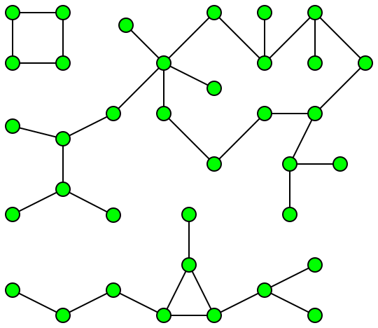
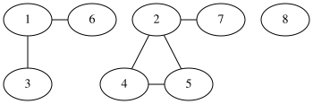

# Гүний хайлт (DFS)


Чиглэлгүй граф өгөгдөхөд граф дахь холбоост бүрдлүүдийн тоог болон холбоост бүрдэл тус бүрийн хэмжээг ол.



Зурагт 3 холбоост бүрдэл байх ба хамгийн том бүрдлийн хэмжээ нь 22 байна.

Таны програм `n <= 10,000` оройтой граф дээр **1 секундын** хугацаанд ажиллах ёстой.

## Оролт

Эхний мөрөнд графын оройн тоо `n`, ирмэгийн тоо `m` өгөгдөнө.

Дараагийн `m` мөр бүрд ирмэгийг дүрслэх `x`, `y` гэсэн хоёр бүхэл тоо өгөгдөнө. Энэ нь `x`, `y` хоёр оройн хооронд ирмэг байгааг илэрхийлнэ.

Оройн дугаар 1-ээс эхэлнэ.

### Жишээ оролт

```
8 6
1 6
1 3
2 7
2 5
2 4
4 5
```

Дээрх оролтоор дараах граф үүснэ.



## Гаралт

Эхний мөрөнд графын холбоост бүрдлүүдийн тоог хэвлэнэ.

Хоёр дахь мөрөнд холбоост бүрдэл тус бүрийн оройн тоог нэг хоосон зайгаар тусгаарлан буурах дарааллаар хэвлэнэ.

### Жишээ гаралт

```
3
4 3 1
```

## Хэрэгжүүлэх заавар

Энэ даалгаварт дараах үйлдлүүдийг гүйцэтгэнэ.

1. Графын өгөгдлийг гараас авч, `Graph` бүтцэд хадгална.
2. `gr_connected_components()` функцийг дуудаж холбоост бүрдлүүдийн мэдээллийг олно.
3. `single_pivot_qsort()` функцийг дуудаж холбоост бүрдлүүдийн хэмжээг буурах дарааллаар эрэмбэлнэ.
4. Эрэмбэлсэн холбоост бүрдлүүдийн мэдээллийг хэвлэнэ.

### Графыг хадгалах

Графыг хөршийн жагсаалт (Adjacency List) ашиглан хадгална.

Графын мэдээллийг `Graph` бүтцэд хадгална.

```c
struct Graph {
    int n;      // Оройн тоо
    int m;      // Ирмэгийн тоо
    List *adj;  // Хөршийн жагсаалт
};

typedef struct Graph Graph;
```

Граф бүтцийг ашиглахаас өмнө `gr_init_graph()` функцийг дуудаж графыг эхлүүлнэ.

Жишээ нь `n` оройтой графыг дараах байдлаар үүсгэнэ.

```c
Graph G;
gr_init_graph(&G, n);
```

Хөрш оройнуудыг `adj` жагсаалтан хүснэгтэд хадгална.

`G.adj[u]` жагсаалтад `u` оройтой хөрш бүх оройг хадгална.

Жишээ нь `2`, `4` оройнууд хөрш бол:

```c
l_push_back(&G.adj[2], 4);
```

гэж `G.adj[2]` жагсаалтын төгсгөлд `4` утгыг оруулна.

Чиглэлгүй граф учраас эсрэг чиглэлийн холбоосыг мөн хадгална.

```c
l_push_back(&G.adj[4], 2);
```

Жагсаалтын хувьд 8-р даалгавар дээр хэрэгжүүлсэн жагсаалтын кодыг авч ашиглаж болно.

```c
void l_push_back(List *, int);
void l_push_front(List *, int);
void l_insert(List *, int, int);
void l_pop_front(List *);
void l_pop_back(List *);
void l_erase(List *, int);
void l_print(List *);
Elm *l_search(List *, int);
```

`u` оройн бүх хөрш оройгоор дараах байдлаар давтана.

```c
Elm *i;

for (i = G.adj[u].head; i != NULL; i = i->next) {
    // i->x нь u оройн хөрш юм.
    // ...
}
```

### Аль хэдийн хэрэгжүүлсэн функц

#### Графыг эхлүүлэх функц

Графын хөршүүдийг хадгалах жагсаалтан хүснэгтийг эхлүүлнэ. Санах ойг бэлтгэж, жагсаалтын `head`, `tail` утгуудад `NULL`, `len` утгад `0` онооно.

```c
void gr_init_graph(Graph *g, int n)
{
    int i;

    g->adj = (List *) malloc(sizeof(List) * (n + 1));
    g->n = n;

    for (i = 0; i <= n; i++) {
        g->adj[i].head = g->adj[i].tail = NULL;
        g->adj[i].len = 0;
    }
}
```

### Хэрэгжүүлэх функцүүд

#### 1. Ирмэг нэмэх функц

```c
void gr_add_edge(Graph *g, int x, int y);
```

`g` графын ирмэгүүдийг хадгалах `adj` жагсаалтан хүснэгтэд ирмэг нэмнэ.

Уг граф нь чиглэлгүй тул `x`-ээс `y`, `y`-ээс `x` гэсэн хоёр холбоосыг оруулна.

#### 2. Холбоост бүрдлүүдийг олох функц

```c
void gr_connected_components(Graph *g, int *cc);
```

`g` граф дээр гүний хайлт (DFS) хийж холбоост бүрдлүүдийг олно. Үр дүнг `cc` хүснэгтэд хадгална.

- `cc[0]` — нийт холбоост бүрдлийн тоо.
- `cc[1]`-ээс `cc[cc[0]]` хүртэл — холбоост бүрдэл тус бүрийн оройн тоо.

Холбоост бүрдлүүдийн оройн тооны нийлбэр `n`-тэй тэнцүү байх ёстой.

Жишээ нь:

| Индекс | 0 | 1 | 2 | 3 |
|--------|---|---|---|---|
| cc     | 3 | 3 | 4 | 1 |

Графт 3 холбоост бүрдэл байгаа тул `cc[0] = 3` байна.

Холбоост бүрдлүүдийг олохдоо гүний хайлт ашиглана.

Очиж үзээгүй орой бүрээс гүний хайлтыг эхлүүлнэ. Нэг гүний хайлтаар очсон бүх орой тухайн холбоост бүрдэлд харьяалагдана.

Гүний хайлтыг рекурсив эсвэл стек ашигласан хэлбэрээр хэрэгжүүлж болно.

### Эрэмбэлэх

Өмнөх даалгаварт хэрэгжүүлсэн QuickSort алгоритмыг ашиглан холбоост бүрдлүүдийн хэмжээг буурах дарааллаар эрэмбэлнэ.

```c
single_pivot_qsort(cc, 1, cc[0]);
```

## Хугацааны үнэлгээ

Гүний хайлтын алгоритм O(n + m) хугацаанд ажиллах ёстой.

## Автомат үнэлгээ

Таны програм GitHub Actions ашиглан автоматаар шалгагдана.

| Тест | Оройн тоо | Оноо |
|------|-----------|------|
| Sample | 20 | 1 |
| Small | 100 | 4 |
| Big | 10000 | 5 |
| **Нийт** | | **10** |

Тест бүрийн ажиллах хугацааны хязгаар 1 секунд байна.

Кодоо `main` branch руу commit, push хийсний дараа автомат үнэлгээ ажиллана.

Үнэлгээний дэлгэрэнгүй үр дүнг repository-ийн **Actions** хэсгээс харах боломжтой.

Авсан оноо README-ийн дээд хэсэгт байрлах Points badge дээр автоматаар шинэчлэгдэнэ.
